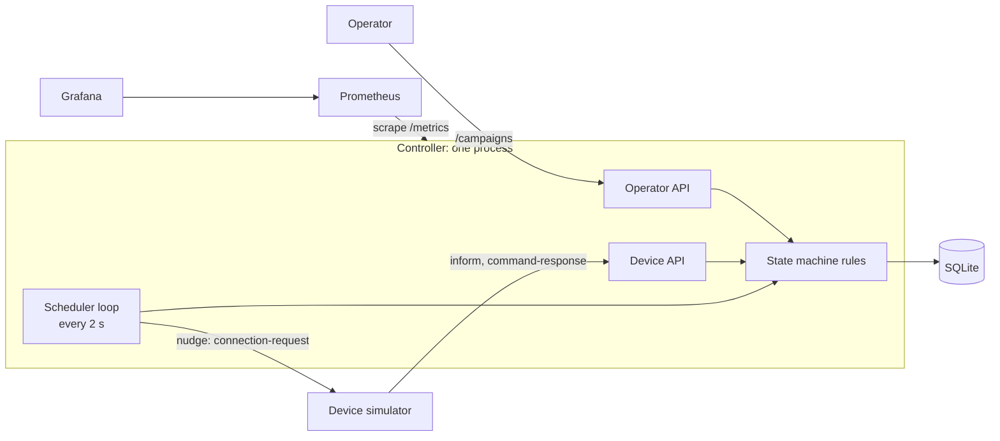
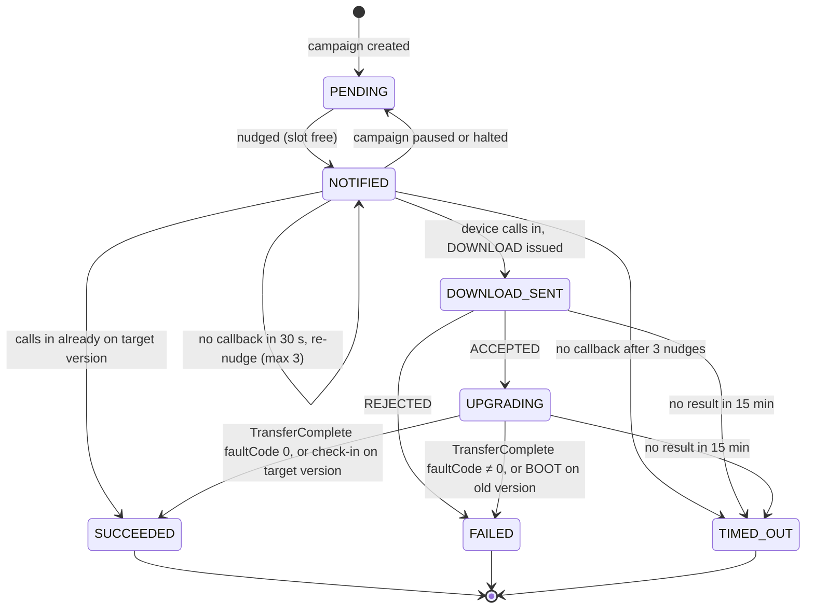

# Firmware Upgrade Campaign Controller

A small device-management controller that runs a firmware upgrade campaign across a fleet of
simulated home gateways. It nudges devices, hands out DOWNLOAD commands when they call in,
correlates results across reboots, and tracks every device through an explicit state machine,
with concurrency limits, timeouts, auto-halt, pause/resume, crash recovery and Prometheus metrics.

- [Quick start](#quick-start-docker-compose)
- [API](#api)
- [Architecture](#architecture)
- [State machine](#state-machine)
- [Design decisions and trade-offs](#design-decisions-and-trade-offs)
- [Configuration](#configuration)
- [Observability](#observability)
- [Testing](#testing)
- [Known limitations](#known-limitations)
- Run report: [RUN_REPORT.md](RUN_REPORT.md) · Scaling note: [SCALING.md](SCALING.md)

---

## Quick start (Docker Compose)

Requires Docker with Compose.

```bash
git clone <repo-url> firmware-upgrade-controller
cd firmware-upgrade-controller
docker compose up --build -d
```

This starts four containers:

| Service | URL | Purpose |
|---|---|---|
| controller | http://localhost:8080 | This project. Interactive API docs at `/docs`, metrics at `/metrics` |
| simulator | http://localhost:9000 | The provided device simulator, 1,000 devices on 1.0.0 |
| prometheus | http://localhost:9090 | Scrapes `controller:8080/metrics` every 5 s |
| grafana | http://localhost:3000 | Pre-provisioned "Firmware campaign" dashboard, no login |

Start a campaign:

```bash
curl -X POST localhost:8080/campaigns -H "Content-Type: application/json" -d '{
  "targetVersion": "2.0.0",
  "imageUrl": "http://example.com/firmware-2.0.0.bin",
  "deviceFilter": {"currentVersion": "1.0.0"},
  "maxConcurrent": 100,
  "failureThresholdPercent": 20
}'
```

Watch it:

```bash
curl localhost:8080/campaigns/1             # progress: counts per state, failure rate, status
curl localhost:9000/_admin/summary          # simulator ground truth, for comparison
docker compose logs -f controller           # every message and state transition
```

Useful operations:

```bash
curl -X POST localhost:8080/campaigns/1/pause
curl -X POST localhost:8080/campaigns/1/resume
docker compose restart controller           # crash/restart mid-campaign: it resumes where it left off
DEVICE_COUNT=50 docker compose up -d        # smaller fleet
docker compose down -v                      # stop and delete the database (clean rerun)
```

With the simulator's default timings (reboots up to 4 minutes, check-ins every 5 minutes), a
1,000-device campaign at `maxConcurrent: 100` takes roughly 25–35 minutes.

### Running without Docker

```bash
python3 -m venv .venv && source .venv/bin/activate
pip install -r requirements.txt

# terminal 1
uvicorn controller:app --port 8080 --log-level warning

# terminal 2
CONTROLLER_URL=http://localhost:8080 DEVICE_COUNT=1000 uvicorn device_simulator:app --port 9000
```

Run both from the project folder (`config.yaml` is read from the working directory).
For quick experiments the simulator accepts `PERIODIC_INFORM_SEC`, `REBOOT_MAX_SEC`,
`LATE_EXTRA_SEC` and the `P_*` behaviour probabilities as environment variables.

---

## API

### Operator

| Method and path | Description | Responses |
|---|---|---|
| `POST /campaigns` | Create and start a campaign for every device on `deviceFilter.currentVersion` | `201` created · `400` no matching devices · `409` another campaign is RUNNING or PAUSED · `422` invalid body · `502` simulator unreachable |
| `GET /campaigns/{id}` | Progress | `200` · `404` |
| `POST /campaigns/{id}/pause` | Stop issuing new work; in-flight devices finish | `200` (also if already paused) · `404` · `409` if COMPLETED or HALTED |
| `POST /campaigns/{id}/resume` | Continue a paused campaign | `200` (also if already running) · `404` · `409` if COMPLETED or HALTED |

`maxConcurrent` must be ≥ 1 and `failureThresholdPercent` between 0 and 100.

Example progress response:

```json
{
  "id": 1, "status": "RUNNING", "targetVersion": "2.0.0", "totalDevices": 1000,
  "counts": {"PENDING": 412, "NOTIFIED": 3, "DOWNLOAD_SENT": 1, "UPGRADING": 96,
             "SUCCEEDED": 431, "FAILED": 35, "TIMED_OUT": 22},
  "failureRatePercent": 11.7, "finishedDevices": 488
}
```

### Device (called by the simulator)

| Method and path | Description |
|---|---|
| `POST /devices/{deviceId}/inform` | Device session. The response carries any pending command, e.g. a DOWNLOAD |
| `POST /devices/{deviceId}/command-response` | Device accepts or rejects a command |

### Operations

`GET /metrics` (Prometheus format) · `GET /docs` (interactive API docs)

---

## Architecture



| File | Responsibility |
|---|---|
| `controller.py` | FastAPI app: operator and device endpoints, state machine rules, scheduler loop, request metrics middleware |
| `db.py` | All SQL. Every state change is a compare-and-set (`WHERE state = ?`) |
| `metrics.py` | Prometheus counters, plus a collector that reads campaign and device counts from the database on each scrape |
| `config.py` / `config.yaml` | Tuning parameters |
| `device_simulator.py` | The provided simulator (unchanged), built into its own image |
| `monitoring/` | Prometheus scrape config and the provisioned Grafana dashboard |

The controller is deliberately one process with one database. The database is the only source
of truth: nothing that matters lives in memory, so the controller can be killed and restarted at
any point and the scheduler simply carries on from the stored states.

**Data model.** `campaigns` holds one row per campaign (settings and status). `device_upgrades`
holds one row per device per campaign: state, commandKey, nudge count and `updated_at`, which is
when the device entered its current state and drives every timeout.

**Scheduler.** Every 2 seconds it: (1) handles timeouts, (2) halts a campaign whose failure rate
is too high, (3) completes a campaign with nothing left to do, (4) fills free `maxConcurrent`
slots by nudging PENDING devices.

---

## State machine



| Group | States | Meaning |
|---|---|---|
| In flight | NOTIFIED, DOWNLOAD_SENT, UPGRADING | Count toward `maxConcurrent`; each has a timeout |
| Awaiting result | DOWNLOAD_SENT, UPGRADING | An order was sent; a result message may arrive |
| Final | SUCCEEDED, FAILED, TIMED_OUT | Never change again |

A result arriving while a device is still DOWNLOAD_SENT (its ACCEPTED was lost) is handled the
same way as from UPGRADING.

Campaign status: `RUNNING` → `COMPLETED` (every device final), `HALTED` (failure threshold),
or `PAUSED` ⇄ `RUNNING` (operator). COMPLETED and HALTED are final.

---

## Design decisions and trade-offs

**1. Correlating results across the reboot.** A TransferComplete is applied only if its
`commandKey` matches the order stored for that device. Anything else is logged and ignored.

**2. Devices that come back without a TransferComplete (requirement 4).** The reported firmware
version is the evidence:
- BOOT on the target version: SUCCEEDED. BOOT on the old version: FAILED (reverted).
- Any later check-in (PERIODIC, CONNECTION_REQUEST) on the target version: SUCCEEDED. This also
  recovers devices whose BOOT and TransferComplete were both lost.
- A check-in on the *old* version proves nothing (a real device may still be downloading), so it
  keeps waiting until a BOOT, a report or the timeout.
- `GET /devices` is used only to select a campaign's devices, never to poll for results.

**3. First result wins.** Once a device is SUCCEEDED, FAILED or TIMED_OUT it never changes.
Duplicates and late messages are logged and counted (`controller_ignored_messages_total`) but
not applied, so counts never go backwards and nothing is double-counted.
*Alternative considered:* let an explicit TransferComplete override a result inferred from BOOT,
or let late proof override TIMED_OUT. More accurate in rare cases, but counts could change after
the fact and the failure rate driving auto-halt would be less stable.

**4. Which retries are safe (requirement 7).**

| Waiting state | Timeout | On timeout | Why |
|---|---|---|---|
| NOTIFIED | 30 s | Re-nudge, up to 3 nudges, then TIMED_OUT | A nudge is harmless to repeat; a device answers within ~3 s or not at all |
| DOWNLOAD_SENT | 15 min | TIMED_OUT, no new order | The device may already be installing |
| UPGRADING | 15 min | TIMED_OUT, no new order | Download plus reboot takes up to ~4.5 min, late reports up to 10 min more |

A *new* order (new commandKey) is never issued. The *same* order is re-sent in one case: a
DOWNLOAD_SENT device that checks in again on the old version never received it. Testing showed
this happens when the DOWNLOAD goes out in reply to a duplicate inform, whose response the
simulator discards; without the re-send, a healthy device would sit out the 15-minute timeout and
count as a failure. Re-sending the same commandKey is safe because any eventual report still
correlates to it.

**5. No separate REBOOTING state.** The controller cannot observe a reboot starting; the device
just goes quiet. UPGRADING covers download and reboot together.

**6. Compare-and-set on every state change.** Each update states the state it expects
(`UPDATE ... WHERE state = ?`) and reports whether it applied. This keeps the state machine
correct when two things race, for example a device answering a nudge while the scheduler, working
from a list it read earlier, is about to re-nudge it. It is also what would let several controller
instances share one database safely.

**7. Enforcing `maxConcurrent` (requirement 5).** NOTIFIED, DOWNLOAD_SENT and UPGRADING all hold
a slot. Orders go only to NOTIFIED devices, the ones the scheduler admitted; a PENDING device that
calls in on its own gets nothing until a slot is free. A device is marked NOTIFIED *before* it is
nudged, so a fast callback cannot arrive while it is still PENDING.

**8. Auto-halt (requirement 6).** Failure rate = (FAILED + TIMED_OUT) / finished devices, so
devices still in progress do not dilute it. The campaign halts when the rate *exceeds* the
threshold after at least `min_sample_size` devices have finished. On halt, no new devices are
nudged, devices already installing are still tracked to a final state, and nudged-but-not-ordered
devices return to PENDING. HALTED is final; to continue, investigate and start a new campaign.
`min_sample_size` is 200 rather than 50: rejects fail within a second and offline devices within
about 90 s, while successes take minutes, so the earliest finished devices over-represent failures.
With 50 the default fleet halted on a false alarm (see the run report).

**9. Pause and resume.** Pause stops new nudges and orders but keeps recording results for devices
already in flight (they cannot be stopped mid-install). Repeating pause or resume is harmless.

**10. One active campaign at a time.** A device's messages are matched to its newest campaign, so
two active campaigns over the same devices would starve the older one (observed in testing).
Creating a campaign while another is RUNNING or PAUSED returns `409`.

**11. Atomic campaign creation.** The campaign and all its device rows are inserted in one
transaction, so a crash during creation leaves either the whole campaign or nothing.

**12. Survives a restart (requirement 8).** All state is in SQLite (a Docker volume). On restart
the scheduler resumes from the stored states; no device is sent a second new order. Messages sent
while the controller is down are lost (the simulator does not retry), and are recovered by the
next check-in on the target version or by the timeouts.

**13. SQLite and a single process.** Enough for this fleet and the simplest thing that survives a
restart. All database access is in `db.py`, so moving to Postgres is contained. See
[SCALING.md](SCALING.md) for what changes at millions of devices.

---

## Configuration

`config.yaml`:

| Setting | Value | Reasoning |
|---|---|---|
| `scheduler.tick_seconds` | 2 | Fast enough to refill slots promptly; cheap at this scale |
| `timeouts.notify_timeout_sec` | 30 | Simulator devices call back 0.2–3 s after a nudge |
| `timeouts.max_nudges` | 3 | Rides out a lost nudge or a brief blip; offline devices are given up after ~90 s |
| `timeouts.result_timeout_sec` | 900 | Download (≤20 s) + reboot (≤240 s) + late report (≤600 s), with margin |
| `auto_halt.min_sample_size` | 200 | Large enough that early, fast failures do not trigger a false halt (decision 8) |
| `simulator_url` | `http://localhost:9000` | Overridden by `SIMULATOR_URL` (Compose sets it) |
| `db_path` | `controller.db` | Overridden by `DB_PATH` (Compose uses a volume) |

`maxConcurrent` and `failureThresholdPercent` are per-campaign and come from the request.

---

## Observability

**Metrics** (`/metrics`, Prometheus format):

| Metric | Labels | Shows |
|---|---|---|
| `controller_requests_total` | endpoint, method, status | Requests received, by endpoint and status code, including 404/422/500 |
| `controller_request_duration_seconds` | endpoint | Response time histogram |
| `controller_outgoing_requests_total` | endpoint, status | Nudges and device-list calls sent; status code or `error` |
| `controller_informs_total` | event | BOOT, PERIODIC, CONNECTION_REQUEST, TRANSFER_COMPLETE received |
| `controller_command_responses_total` | status | ACCEPTED / REJECTED |
| `controller_ignored_messages_total` | reason | Duplicates and late messages (`already_final`, `unknown_command_key`) |
| `controller_downloads_sent_total` | | DOWNLOAD commands issued |
| `controller_renudges_total` | | Repeated nudges |
| `controller_timeouts_total` | from_state | Devices given up on, by the state they timed out in |
| `controller_campaign_devices` | campaign, state | Devices per state (read from the database, so correct after a restart) |
| `controller_campaign_status` | campaign, status | Current campaign status |

Request counting is a middleware, so every request is counted with its final status code,
including ones rejected before reaching an endpoint.

**Dashboard.** Grafana (http://localhost:3000) shows campaign status, devices per state over
time, failure rate against the threshold, in-flight devices, request and error rates by endpoint
and status, `/inform` p95 latency, controller actions and device messages per minute.

**Logs.** Every inform and response, and every state transition with its reason, e.g.
`UPGRADING -> FAILED (TransferComplete faultCode 9010)`.

---

## Testing

Each behaviour was exercised against the simulator, usually by turning up one behaviour with its
`P_*` setting and comparing `/campaigns/{id}` with `/_admin/summary`:

| Scenario | How | Result |
|---|---|---|
| One order per device despite duplicates | Default duplicates (5%) | No device received a second new order |
| Results from TransferComplete and BOOT | `P_FAULT=0.3 P_REVERT=0.3` | Counts matched the simulator's truth |
| Rejections | `P_REJECT=0.3` | REJECTED devices became FAILED |
| `maxConcurrent` | `maxConcurrent: 3`, default 5-min check-ins | Never more than 3 in flight; reached by nudges |
| Offline devices | `P_OFFLINE=0.3` | 3 nudges, then TIMED_OUT; campaign completed |
| Controller restart mid-campaign | Stop/start the controller during upgrades | No repeated orders; lost reports recovered by check-ins or timed out |
| Auto-halt | High failure rate, low `min_sample_size` | HALTED; remaining devices untouched |
| Pause / resume | 20 devices, `maxConcurrent: 2` | No nudges while paused; in-flight finished; resumed to COMPLETED |
| Second active campaign | Create while one is RUNNING | `409` |
| Invalid input | `maxConcurrent: 0`, unknown campaign | `422`, `404` |
| Lost order (duplicate inform) | 40 devices, default duplicates | Order re-sent with the same commandKey; counts matched truth |

---

## Known limitations

- **One active campaign at a time** (decision 10). Supporting overlapping campaigns would need
  explicit device ownership.
- **First result wins.** A device marked TIMED_OUT that later proves it upgraded stays TIMED_OUT.
- **Messages sent while the controller is down are lost**, because the simulator does not retry
  (real TR-069 devices do). Failed devices whose report was lost are only resolved by the timeout.
- **Single process, synchronous SQLite calls.** Fine for thousands of devices; see SCALING.md
  for multiple instances.
- **No authentication** on the operator API.

---

## Project structure

```
controller.py          endpoints, state machine rules, scheduler
db.py                  database access (SQLite)
metrics.py             Prometheus metrics
config.py, config.yaml tuning parameters
device_simulator.py    provided simulator
Dockerfile             controller image
Dockerfile.simulator   simulator image
docker-compose.yml     controller + simulator + Prometheus + Grafana
monitoring/            Prometheus config and Grafana dashboard
results/               output of the 1,000-device run
RUN_REPORT.md          run report
SCALING.md             note on scaling to millions of devices
```
