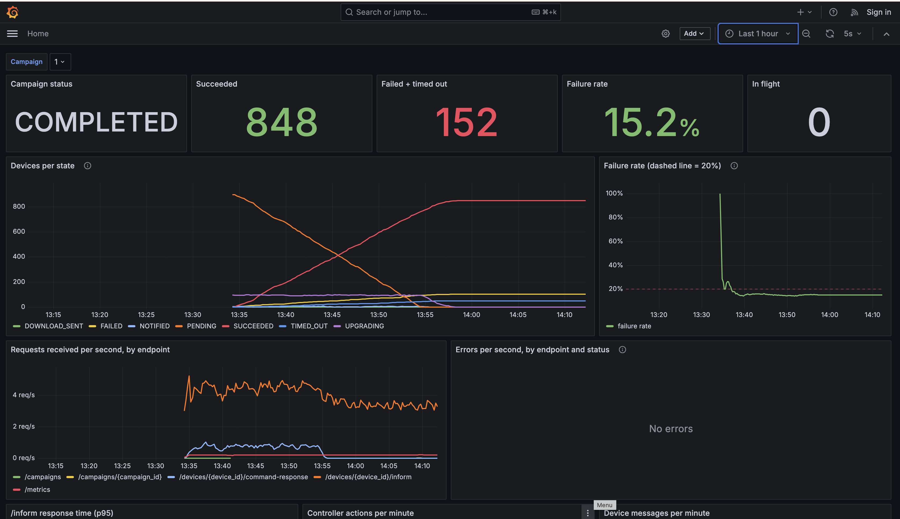
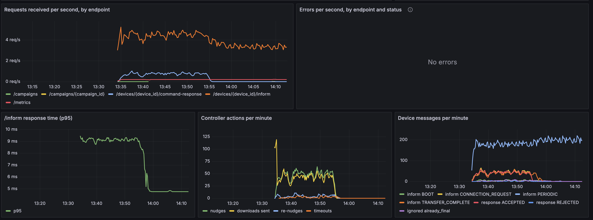

# Run report: 1,000-device campaign

## Setup

| | |
|---|---|
| Fleet | Provided simulator, defaults: 1,000 devices, seed 42, periodic inform every 300 s, reboot 5–240 s, 5% duplicate and 5% late callbacks |
| Campaign | `1.0.0` → `2.0.0`, `maxConcurrent: 100`, `failureThresholdPercent: 20` |
| Controller config | Defaults from `config.yaml`: nudge timeout 30 s × 3 nudges, result timeout 900 s, `min_sample_size: 200` |
| Started with | `docker compose down -v && docker compose up --build -d` |
| Disruption | `docker compose restart controller` about 6 minutes into the campaign |

## Result

The campaign **COMPLETED in 24 min 21 s** (created 08:04:03 UTC, completed 08:28:24 UTC).

| Final state | Devices | Simulator ground truth |
|---|---|---|
| SUCCEEDED | **848** | 848 devices on 2.0.0 |
| FAILED | **103** | 104 failing devices (36 reject + 45 fault + 23 revert) |
| TIMED_OUT | **49** | 48 offline devices |
| **Failure rate** | **15.2%** | (152 / 1,000), below the 20% threshold |

Every SUCCEEDED device really is on 2.0.0, and no device on 2.0.0 was counted as a failure.
The one difference, a fault device counted as TIMED_OUT rather than FAILED, is explained below
under the restart.

### How each device's outcome was decided

From the controller's transition log (`UPGRADING -> FAILED (reason)` lines), matched against the
simulator's hidden profiles:

| Simulator profile | Devices | Controller outcome | Evidence used |
|---|---|---|---|
| healthy | 815 | SUCCEEDED | TransferComplete faultCode 0 (773), or BOOT on 2.0.0 before a late TransferComplete (41), or a PERIODIC inform on 2.0.0 (1) |
| no_tc | 33 | SUCCEEDED | BOOT on 2.0.0, with no TransferComplete ever sent |
| fault | 45 | FAILED (44), TIMED_OUT (1) | TransferComplete faultCode 9010; one report was lost during the restart |
| revert | 23 | FAILED | BOOT on old version 1.0.0, no TransferComplete |
| reject | 36 | FAILED | REJECTED UNSUPPORTED_IMAGE |
| offline | 48 | TIMED_OUT | No callback after 3 nudges |

### Observations from the dashboard



- **`maxConcurrent` held.** About 100 devices were in flight throughout, until PENDING ran out
  around minute 21; then in-flight drained to zero.
- **Throughput:** up to about 5 informs per second; about 40–60 nudges and DOWNLOAD commands per
  minute at steady state.
- **Latency:** `/inform` p95 stayed under 10 ms (mean 2.2 ms).
- **No errors:** every request returned 2xx; the errors panel stayed empty for the whole run.
- **Duplicates and late callbacks:** 88 messages arrived for devices already in a final state
  (duplicate or late TransferComplete/BOOT). All were logged and ignored; none changed a count.



Raw data: `results/campaign.json`, `results/simulator_truth.json`, `results/metrics.txt`.
(The counters in `metrics.txt` cover the period after the controller restart; counters reset
on restart, while the per-state device counts come from the database.)

---

## Surprises and findings

### 1. The first attempt halted on a false alarm

With the original `min_sample_size: 50`, the same campaign **HALTED after about 1.5 minutes**:

```
campaign 1 HALTED: failure rate 26.9% > 20.0% after 52 finished devices
```

Once the devices already in flight had finished, the same campaign's failure rate was
**14.9% over 141 devices**, almost exactly the final 15.2%. The halt was not caused by a bad rollout.

**Cause: failures finish faster than successes.** A REJECTED device is final within a second, and
an offline device within about 90 seconds (3 nudges), while a successful upgrade takes on average
over 2 minutes (download plus reboot). With 100 devices started at once, the first 50 to finish
over-represent failures. The failure-rate panel shows the same shape in the successful run: a spike
at the start, then settling near 15%.

**Change:** `min_sample_size` raised to 200, about two rounds of `maxConcurrent`. A sample-size
rule should be judged against how quickly each outcome becomes visible, not just the count.
(Evidence: `results/halted-run/`.)

### 2. A controller restart loses in-flight reports

The controller was restarted about 6 minutes in. It was unreachable for only a couple of seconds,
but the simulator logged **13 failed callbacks** in that window, and it does not retry them.
The campaign then carried on from the database with no repeated orders, and two of those lost
callbacks mattered:

- **A healthy device's TransferComplete was lost.** It was recovered at the device's next periodic
  inform, which reported 2.0.0 (`UPGRADING -> SUCCEEDED (PERIODIC on target version)`).
  This is why any check-in on the target version counts as evidence.
- **A fault device's TransferComplete (GW-BA0266EFBE05) was lost.** Its later check-ins said 1.0.0,
  which proves nothing on its own (a real device could still be downloading), so it waited out the
  15-minute result timeout and ended **TIMED_OUT instead of FAILED**. It still counts toward the
  failure rate, so the decision to halt would have been the same; only its label differs.

Real TR-069 devices retry a failed inform, so in production these reports would most likely arrive
after the restart. The timeout is the safety net for when they do not.

### 3. Orders can be lost when sent in reply to a duplicate inform (found in testing)

In a 40-device test, one healthy device stayed in DOWNLOAD_SENT until its timeout. The trace
showed the DOWNLOAD had been sent in reply to a *duplicate* PERIODIC inform, and the simulator
ignores replies to duplicates, so the device never received it. Its real CONNECTION_REQUEST a
second later got nothing, because it was already DOWNLOAD_SENT.

**Fix:** when a DOWNLOAD_SENT device that never acknowledged its order calls in again on the old
version, the controller re-sends the **same** order with the **same** commandKey. A new order is
still never issued. After the fix the 40-device test matched the simulator exactly. The situation
did not occur in this 1,000-device run.

### 4. Overlapping campaigns starve the older one (found in testing)

Creating a second campaign while the first was still running made both campaigns claim the same
devices. Device messages are matched to the newest campaign, so the older one received nothing and
its devices timed out even though they upgraded. The controller now refuses a second active
campaign with `409`.
